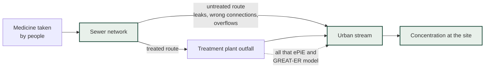
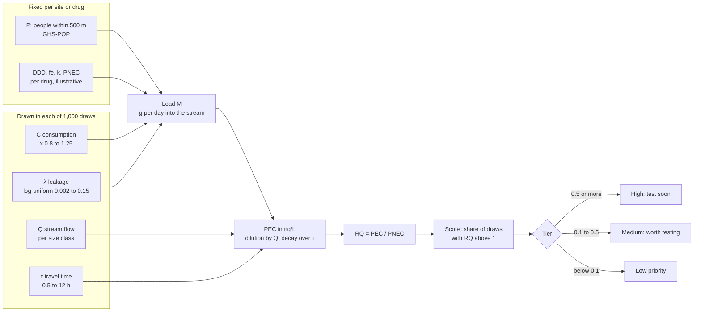
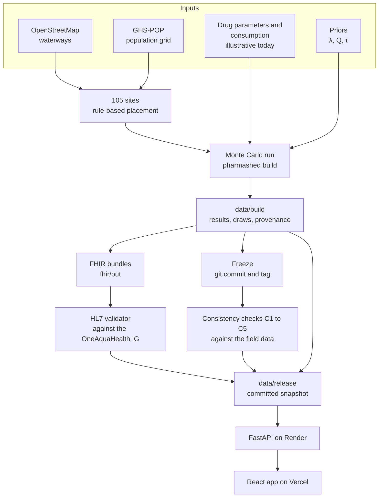
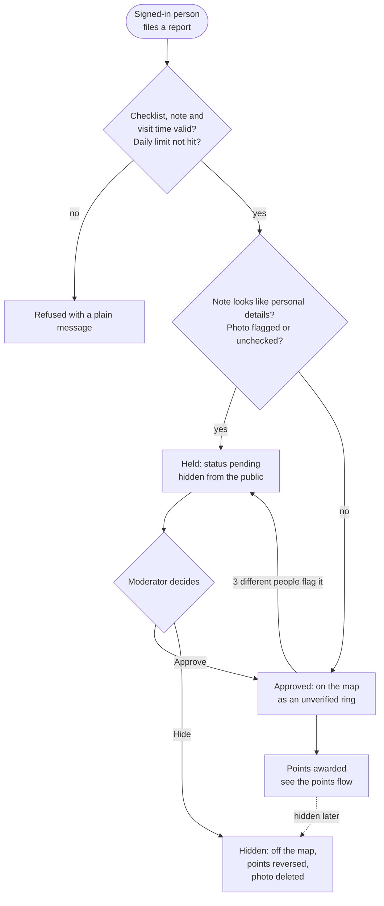
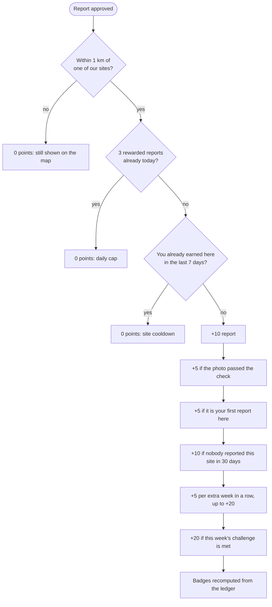
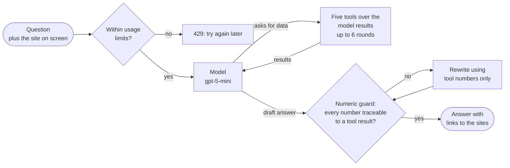
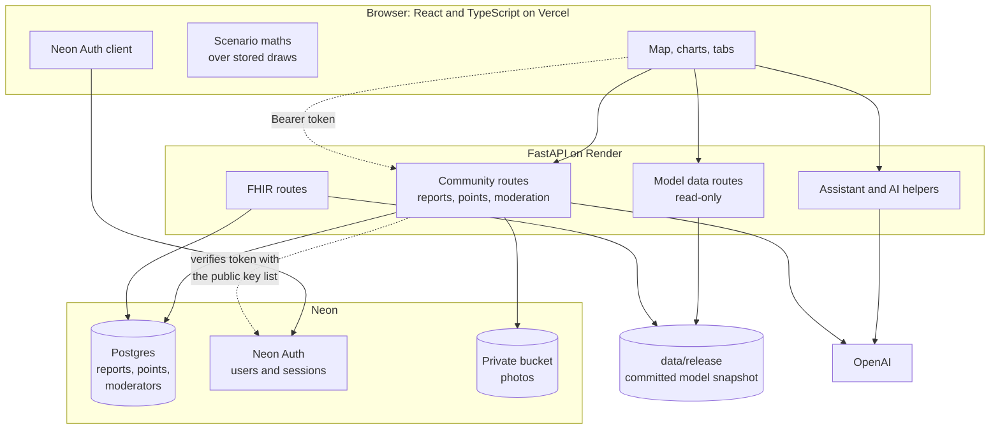

# PharmaShed

**Sampling-priority screening for pharmaceuticals in urban streams, with citizen reports and FHIR output.**

PharmaShed tells an environmental officer **where to take water samples first**, before anyone leaves the office. It models a route that existing tools leave out (medicine reaching a stream through leaking sewers, wrong connections and overflows), shows the result on an interactive map, explains it in plain language, and lets the public add what they see. Built for the **IEEE OneAquaHealth Global Hackathon 2026**, Track 7 (Digital Health Standards).

**Live demo:** [pharmashed.roshankhan.me](https://pharmashed.roshankhan.me) · **API docs:** [pharmashed.onrender.com/docs](https://pharmashed.onrender.com/docs)

> **Honest status.** The model, the pipeline, the app and the FHIR output are real and tested. The **drug parameters and consumption values are illustrative placeholders**, deliberately round numbers, badged as such everywhere in the app and in every FHIR resource. Replacing two data files with sourced values recomputes everything. See [What is real and what is illustrative](#what-is-real-and-what-is-illustrative).

---

## Contents

1. [The problem and the research behind it](#the-problem-and-the-research-behind-it)
2. [What you can do in the app](#what-you-can-do-in-the-app)
3. [How the model works](#how-the-model-works)
4. [What is real and what is illustrative](#what-is-real-and-what-is-illustrative)
5. [Citizen reports, points and moderation](#citizen-reports-points-and-moderation)
6. [FHIR output](#fhir-output)
7. [The AI assistant](#the-ai-assistant)
8. [Architecture and stack](#architecture-and-stack)
9. [Run it locally](#run-it-locally)
10. [Configuration](#configuration)
11. [Deploying](#deploying)
12. [API reference](#api-reference)
13. [Repository layout and docs](#repository-layout-and-docs)
14. [Testing](#testing)
15. [Limits and what comes next](#limits-and-what-comes-next)
16. [Credits and citation](#credits-and-citation)

---

## The problem and the research behind it

Existing exposure models for pharmaceuticals in rivers, such as **ePiE** and **GREAT-ER**, route drug load through wastewater treatment plant (WWTP) outfalls. That works when a plant sits on the stream you are studying. A model that only follows treatment-plant outfalls has nothing to say about a stream without one: it predicts a concentration of about zero.

Field data say that is not the whole story. A 2025 study by Rodrigues and colleagues ([*J. Hazard. Mater.* 499:139946](https://doi.org/10.1016/j.jhazmat.2025.139946)) sampled **102 urban stream sites in five European cities** (Coimbra, Toulouse, Benevento, Ghent, Oslo) and found pharmaceuticals at **91 % of sites** and mixtures at 79 %, with irbesartan, bisoprolol and carbamazepine in more than half of them and Toulouse the most contaminated city.

PharmaShed is built on that study. It uses the paper's field data as its reality check (see [consistency checks](#consistency-checks)), and it adds the missing pathway: the **untreated pathway** of sewer leakage, misconnections and combined sewer overflows that bypass treatment entirely.



*PharmaShed models the untreated route, which is the only route at the 105 sites in this dataset (none has a treatment plant on its stream).*

---

## What you can do in the app

The app has two views, switched with the **Citizen | Expert** toggle in the top bar: the same data, written for two audiences. **Citizen** is plain language with no jargon and a short list of tabs. **Expert** adds the maths, the checks and the data standard.

| Tab | View | What it does |
|---|---|---|
| **Home** | both | What the project is, how to use it, what the colours mean, and an ask bar for the assistant. Expert view also shows the architecture and the citations. |
| **Stream map** (Explore) | both | 105 monitoring places in 5 cities as heat-style glows: red = test soon, amber = worth testing, green = lower priority. Filter by city and by medicine. Hover for a card, click for the site page. Citizen reports appear as a separate layer of hollow rings. |
| **Site page** | both | Citizen: testing priority in words, rank in its city, medicines ranked. Expert: concentration bands against the no-effect level, the distribution of simulated outcomes, a sensitivity "tornado", and "what would flip this site". |
| **What if?** (Scenarios) | both | Presets (drought, sewer repair, leakage hotspot) and sliders. The score recomputes live in your browser over the stored draws, and a panel explains in words why it changed. |
| **Consistency** | expert | Five pre-registered checks against the paper's field data. |
| **Methodology** | expert | The equations, the priors table, the model pipeline, the identifiability caveat, and the three-way ablation (full model vs population-only vs treatment-plant-only). |
| **FHIR** | expert | Browse every exported bundle, the validation result, and the "model prediction vs lab result" query demo, co-hosted with the OneAquaHealth IG's own example data. |
| **Leaderboard** | both | Top contributors by nickname, by time period and city. |
| **My streams** | both | Your points, rank, streak, this week's challenge, badges and reports. |
| **Moderation** | moderators only | The review queue for held and flagged reports. |

A floating **Ask a question** button opens the AI assistant from anywhere, already aware of the site you are looking at. The app has a light and a dark theme, and is built to be readable (14 px minimum type, tested contrast).

---

## How the model works

For each site and each drug the engine runs a **Monte Carlo mass balance**: it draws the uncertain inputs from stated ranges 1,000 times, computes a predicted concentration each time, and reports how often that concentration is higher than a level where effects are expected.

$$
\begin{aligned}
L &= \frac{P \cdot C \cdot \mathrm{DDD}}{1000} \\
E &= L \cdot f_e \\
M &= E \cdot \bigl(\lambda + w\,(1-\lambda)(1-R)\bigr) \\
\mathrm{PEC} &= \frac{M}{Q \cdot 86\,400 \cdot 1000}\; e^{-k\tau}\cdot 10^{9} \\
\mathrm{RQ} &= \frac{\mathrm{PEC}}{\mathrm{PNEC}}
\end{aligned}
$$

where $L$ is grams per day consumed near the site, $E$ grams per day excreted unchanged, $M$ grams per day reaching the stream, and $\mathrm{PEC}$ the concentration in ng/L. The **sampling-priority score** is the share of the $N = 1000$ draws in which the risk quotient exceeds 1:

$$
\text{score} = \frac{1}{N}\sum_{i=1}^{N} \mathbf{1}\!\left[\mathrm{RQ}_i > 1\right]
$$



| Symbol | Meaning | How it is set |
|---|---|---|
| `P` | people within 500 m of the site | GHS-POP population grid (real data) |
| `C` | consumption, DDD per 1 000 people per day | country value × a multiplier drawn uniformly from 0.8 to 1.25 (illustrative values) |
| `DDD`, `fe`, `k`, `PNEC` | drug dose, fraction excreted, in-stream loss rate, no-effect level | per drug (illustrative values) |
| `λ` (lambda) | **untreated leakage fraction** | drawn log-uniform from 0.002 to 0.15, informed by Fenz et al. (2005) and the APUSS project |
| `Q` | stream flow, m³/s | drawn log-uniform per size class: S 0.005–0.1, M 0.02–0.5, L 0.1–2.0 |
| `τ` | travel time, hours | drawn uniformly from 0.5 to 12 |
| `w`, `R` | treatment-plant flag and removal efficiency | `w = 0` at every site, so `M = E · λ` |

Key points:

- **The score is never a probability.** It is the share of simulated draws above the threshold, under stated priors. Tiers: **high ≥ 0.5, medium ≥ 0.1**, low below.
- **λ and Q cannot be separated from one sample.** They appear only as the ratio λ/Q, so a single grab sample cannot identify both. PharmaShed carries the joint prior uncertainty through every draw instead of pretending to estimate them separately (decision D08; shown on the Methodology tab).
- **Scenarios need no re-simulation.** The 1,000 draws per site and drug are stored as a compact `float32` file. A scenario multiplies λ, Q or C and rescales each draw in the browser.
- **Sensitivity** is the Spearman rank correlation of each input with the result, shown as a tornado chart, plus the multiplier that would move a site across a tier boundary.
- **Ablation:** the engine can run a *full* model, a *population-only* model, and a *treatment-plant-only* model (the ePiE-like blind spot, which predicts exactly zero for every site here), so the contribution of the untreated pathway is visible.
- **Sites:** 105 sites, 21 per city, placed by a rule-based script along real OpenStreetMap waterways (stratified by population density, at least 500 m apart). They are **synthetic placements**, not the paper's sampling points.

### Consistency checks

Five checks, pre-registered and run against predictions that were **frozen before** any comparison with the field data (the freeze is a git commit and a tag, `predictions-frozen-illustrative-v1`):

| Check | What it tests |
|---|---|
| C1 | Detection share: the fraction of sites predicted above the detection limit |
| C2 | City rank order: Toulouse > Ghent > Benevento > Coimbra ≈ Oslo |
| C3 | Concentration order of magnitude |
| C4 | Cross-drug consistency of rankings |
| C5 | Stability of site rankings across ablation variants |

With illustrative inputs, C1, C2 and C5 pass and **C3 and C4 fail**, and the app says so openly: failing checks on placeholder values are not evidence about the model. The point is the machinery, which will show where the model is wrong once sourced values go in. These are **consistency checks, not a validation**.

---

## What is real and what is illustrative

| Real | Illustrative (and labelled as such) |
|---|---|
| The model equations and the Monte Carlo engine | Drug parameters: PNEC, detection limit (LOD), excretion fraction, loss rate, dose |
| Population around each site (GHS-POP R2023A, 500 m buffers) | National consumption values |
| Stream geometry (OpenStreetMap) | The priors on λ, Q, τ (stated assumptions, marked `assumption`) |
| The freeze and consistency-check pipeline | The placement of the 105 sites (synthetic, on real streams) |
| FHIR export, validated with the official validator | Concentrations: with the 500 m population proxy they are roughly 0.04–3 ng/L, so the placeholder PNEC and LOD values are set in the 0.1–10 ng/L range so that all three tiers appear. This is demo scaffolding, not a finding. |

Every parameter has a provenance entry. A value is `sourced` (a source and an evidence quote), `assumption`, or `illustrative`; an illustrative value never carries a citation. The sourcing pipeline is built (`SOURCING.md`): replacing `data/params/drug_parameters.csv` and `data/consumption/consumption.csv` makes the engine recompute **630,000 draws** (105 sites × 6 drugs × 1,000), every chart and every FHIR bundle.

**Words the project never uses:** "safe" or "unsafe" for a stream (it says "the model estimates concentrations for priority-setting only"); "probability" of harm; "validated" for the model.

### From data to the live app



---

## Citizen reports, points and moderation

The model cannot see a stream; people can. Signed-in users add observations, and these never change a model score. Design and decisions: [`docs/S5-citizen-reports-plan.md`](docs/S5-citizen-reports-plan.md).

**Filing a report** (three steps): pick a spot on the map (or use your location) and a visit time; answer a seven-question checklist (water colour, smell, foam, litter, animals, flow, rain); add an optional note and photo. A pin within 1 km of a model site is linked to it. Reports are shown as an unverified layer, clearly separate from model output. Twenty labelled **sample reports** are seeded so a fresh demo is not empty.

**AI help, always optional:** *Tidy my note* uses `gpt-5-mini` to fix spelling and wording only (it may not add facts or safety claims); the person chooses, and **both versions are stored**. A photo is checked by the model for people and number plates.

**Photos** are decoded and re-encoded server-side as a plain JPEG (which removes GPS and camera metadata), shrunk to 1,280 px, stored in a **private bucket** and served only through short-lived links, and only for approved reports.

### The life of a report



### How points are decided

Points reward useful, honest reports. They are an append-only ledger, so history can be audited and a hidden report can be reversed.

| Event | Points |
|---|---|
| Approved report near one of our sites | +10 |
| Photo that passed the check | +5 |
| Your first report at a site | +5 |
| A site nobody had reported in the last 30 days | +10 |
| Weekly streak, per extra consecutive week | +5, up to +20 |
| Weekly challenge (rotates by week) | +20 |



Seven **badges** (First report, Regular, Explorer, Photographer, Three-week streak, Neglected-stream hero, Challenger) are recomputed from the ledger. The **leaderboard** shows nicknames only, only for people who opt in, by all time, week or 30 days, for everyone or one city.

**Safety and moderation:**
- A note that looks like it contains personal details (an email, a phone number, a handle), a photo the check flags, or a report that **three different people flag** is held for a moderator and not shown publicly.
- A moderator **approves** (it goes public and is scored) or **hides** (it leaves the map, its points and any badge are taken back, and its photo is deleted). Every decision is logged.
- Rate limits on reports, photo uploads, AI calls and flags.
- A plain-language **privacy note** in the app, and **Delete my account**, which removes the profile, reports, flags, points, badges, photos and the sign-in user in one transaction.

**Making someone a moderator:** add a row to the `moderators` table in the database. The grant is by account id, so it needs no environment setting:

```sql
insert into moderators (user_id)
select id::text from neon_auth."user" where email = 'person@example.com';
```

`ADMIN_EMAILS` (a listed **and** verified email) still works as a second route.

---

## FHIR output

Every prediction is published as an HL7 **FHIR R4** `Observation` aligned with the [OneAquaHealth Implementation Guide](https://github.com/hl7-eu/oah):

- `Observation` with the IG's `observation-with-component-oah` profile: PEC at the 5th, 50th and 95th percentile (ng/L), RQ at the median, the priority score and the share below the detection limit, as components; category `model-prediction`; tagged `illustrative-parameter` while parameters are placeholders.
- `Location` resources for the 105 sites (`location-oah` profile), consumption observations, and reference measurements from the field study. The FHIR tab co-hosts the IG's own example data so model output and lab results can live on one server and be told apart by category.
- **Citizen observations** are exported too, as plain FHIR Observations with status `preliminary`, category `citizen-observation` and the tag `unverified`, linked to the site Location, with **no nickname and no free text**. They deliberately do **not** claim the OAH profile, because that profile fixes the status to `final`, which would overstate an unverified report (decision D44). Live at `GET /api/fhir/citizen-observations`.

**Validation:** all **11 bundles** pass the official HL7 FHIR validator (6.10.4) against the OneAquaHealth profiles with **0 errors** and 1,530 warnings (best-practice notes such as missing narrative text). The IG is published only as FSH source, so `scripts/validate_fhir.py` compiles it with SUSHI at a pinned commit (`hl7-eu/oah@b907cf0`) first. This shows the *shape* of the output is valid; it says nothing about whether the numbers inside are right.

---

## The AI assistant

A chat assistant (OpenAI `gpt-5-mini`, with Groq as a fallback) answers questions such as *"Which Oslo sites should I sample first for citalopram?"* It is built so it cannot invent numbers:

- **Five tools only**: `list_priority_sites`, `get_site_profile`, `explain_drivers`, `run_scenario`, `get_provenance`. It calls them in a loop (up to six rounds) and may quote only what they return.
- **A numeric guard** checks every number in the answer against the tool results (with a small allowance for small integers, numbers in the question and rounding). If one is not traceable, the answer is rewritten.
- It always says "under stated assumptions" and never calls a stream safe or unsafe. In citizen view it answers in plain language.
- **Usage limits** protect the key: 20 questions per client per hour and 800 per day, adjustable by environment variable.
- `make eval-assistant` runs a 14-question evaluation set (`eval/questions.yaml`) covering the tools and the safety rails.



---

## Architecture and stack



| Layer | Tools |
|---|---|
| Engine | Python 3.12+, NumPy, SciPy, rasterio (population), pydantic v2; `uv` workspace |
| API | FastAPI, psycopg (pooled), PyJWT (EdDSA token check), boto3, Pillow, OpenAI client |
| Web | Vite, React 19, TypeScript (strict), Zustand, Tailwind v4, MapLibre GL, Lenis, hand-written SVG charts |
| Data and auth | Neon Postgres, Neon Auth, Neon storage |
| Hosting | Vercel (web), Render (API, free plan) |
| Tests | pytest, vitest, Playwright for browser checks |
| Standards | HL7 FHIR R4, OneAquaHealth IG, HL7 FHIR validator, SUSHI |

The model runs **offline, once**, and writes `data/build/`. A small committed snapshot, `data/release/`, is what the deployed API serves, so the live site needs no engine and no large files. The API reads `data/build/` first (local development) and falls back to `data/release/`; `PHARMASHED_DATA` overrides both. The citizen features are optional: with no database the community endpoints answer 503 and the rest of the app works unchanged.

---

## Run it locally

**Prerequisites:** Python 3.12+, [`uv`](https://docs.astral.sh/uv/), Node 20+ with `pnpm`. For FHIR validation also Java 11+ and `npx`.

```bash
uv sync                  # Python workspace (engine + api)
cd web && pnpm install   # web app
cd ..
./dev.sh                 # API on :8000 and web on :5173 together
```

`dev.sh` serves the small **fixture** dataset in `contracts/fixtures` (fast, no model run needed). To see the real engine output instead, run the API with `PHARMASHED_DATA=data/release` (or build your own data below). Open <http://localhost:5173>.

**Citizen features locally** need a Neon project: put `DATABASE_URL` and `NEON_AUTH_BASE_URL` in `.env`, `VITE_NEON_AUTH_URL` in `web/.env.local`, and add your origin (`http://localhost:5173`) to Neon Auth's trusted domains. Add the storage variables for photos and `OPENAI_API_KEY` for the assistant and AI helpers. Without them those parts simply hide.

### Rebuild the data from scratch

```bash
uv run python scripts/fetch_ghspop.py --download   # 4 population tiles (~200 MB) into data/raw/ (git-ignored)
uv run pharmashed population compute               # real populations into data/sites/sites.geojson
uv run python scripts/fill_illustrative.py         # only fills rows still marked todo
uv run pharmashed build                            # model run into data/build/, FHIR into fhir/out/
uv run pharmashed freeze                           # strict run; commits and tags (needs a clean tree)
uv run pharmashed checks                           # consistency checks C1 to C5
uv run python scripts/validate_fhir.py             # official HL7 validator (first run downloads ~200 MB)
uv run python scripts/make_release.py              # refresh the committed snapshot in data/release/
```

Shortcuts live in the `Makefile` (`make run`, `make freeze`, `make checks`, `make fhir`, `make fhir-validate`, `make release`, `make test`, `make eval-assistant`). `docker compose up` in `infra/` starts a local HAPI FHIR server (not exercised in the hosted demo).

---

## Configuration

| Variable | Where | Purpose |
|---|---|---|
| `OPENAI_API_KEY` | API | Assistant, note tidy-up and photo check (`GROQ_API_KEY` is an optional fallback for the assistant) |
| `ASSISTANT_MODEL` | API | Model id, default `gpt-5-mini` |
| `ASSISTANT_IP_LIMIT`, `ASSISTANT_DAILY_LIMIT` | API | Question limits (default 20 per client per hour, 800 per day) |
| `CORS_ORIGINS` | API | Allowed website origins, comma-separated |
| `PHARMASHED_DATA` | API | Data directory (defaults to `data/build`, else `data/release`) |
| `DATABASE_URL` | API | Neon Postgres connection string (use the **pooled** one). Optional |
| `NEON_AUTH_BASE_URL` | API | Neon Auth URL; tokens are verified against `<url>/.well-known/jwks.json` |
| `AWS_ENDPOINT_URL_S3`, `AWS_ACCESS_KEY_ID`, `AWS_SECRET_ACCESS_KEY`, `S3_BUCKET`, `AWS_REGION` | API | Neon storage bucket for photos. Optional |
| `ADMIN_EMAILS` | API | Optional: emails treated as moderators (must be verified). The `moderators` table is the simpler route |
| `VITE_DATA_BASE` | Web | API base URL for the deployed site (`web/.env.production`) |
| `VITE_NEON_AUTH_URL` | Web | Same Neon Auth URL; without it the sign-in controls are hidden |
| `VITE_NEON_AUTH_GOOGLE` | Web | `true` to show "Continue with Google" (only if enabled in Neon Auth) |

`.env` files are git-ignored. Never commit keys.

---

## Deploying

- **Web (Vercel):** import the repo with root `web/`; set `VITE_NEON_AUTH_URL` (`VITE_DATA_BASE` is in `web/.env.production`). Vite inlines these at build time, so redeploy after changing them.
- **API (Render):** the repo has a `render.yaml` blueprint (Python, `uv sync --frozen`, `uvicorn`). Set the secret variables from the table above in the dashboard. The service's health check is `/api/ping`.
- **Database and auth (Neon):** create a project, enable Neon Auth, add your site origins to its trusted domains, and create a storage bucket for photos. Migrations in `api/migrations/` apply themselves on first start, inside one transaction under a lock, so two instances starting together are safe.
- **Free-plan note:** Render's free service sleeps after about 15 minutes idle and takes up to a minute to wake. Point an uptime monitor at `https://<your-api>/api/ping` (it answers `GET` and `HEAD`, and never touches the database) to keep it awake.

---

## API reference

All routes are under `/api`. Interactive docs are at `/docs`.

| Area | Routes |
|---|---|
| Model data | `GET results`, `sites`, `streams`, `draws_index`, `draws.bin`, `provenance`, `provenance/{key}`, `methodology`, `checks`, `glossary`, `meta`; `POST scenario` |
| FHIR | `GET fhir/index`, `fhir/bundle/{name}`, `fhir/citizen-observations` |
| Assistant | `POST assistant`, `GET assistant/status` |
| Health | `GET health`, `GET/HEAD ping` |
| Community (needs the database) | `GET community/status`; `GET/DELETE me`, `PUT me/profile`, `GET me/reports`, `GET me/progress` |
| Reports | `GET/POST reports`, `POST reports/{id}/flag`, `GET flag-reasons`, `POST photos`, `GET photos/{id}`, `POST ai/proofread` |
| Points | `GET leaderboard`, `GET challenge` |
| Moderation (moderators) | `GET admin/reports`, `POST admin/reports/{id}/approve`, `POST admin/reports/{id}/hide` |

Write routes need a Neon Auth bearer token. Public reads (the map, reports, the leaderboard) need none.

---

## Repository layout and docs

```
engine/      Python Monte Carlo engine, consistency checks, FHIR builder (offline)
api/         FastAPI app: model data, assistant, community features, SQL migrations
web/         Vite + React app
contracts/   JSON Schemas, generated TypeScript types, test fixtures (the data contract)
data/        params/ (inputs), consumption/, sites/, build/ (git-ignored), release/ (served), observed/ (see below)
fhir/        terminology, validator script, generated bundles, citizen sample, IG examples
scripts/     data fetching, fixtures, release snapshot, FHIR validation
infra/       docker-compose for a local HAPI FHIR server
eval/        assistant evaluation questions
docs/        S5-citizen-reports-plan.md
```

Project documents, in order of authority: [`CONTEXT.md`](CONTEXT.md) (decisions log D01 to D44) → [`IMPLEMENTATION.md`](IMPLEMENTATION.md) (module specs) → [`SOURCING.md`](SOURCING.md) (how values get sourced) → [`CHECKPOINT.md`](CHECKPOINT.md) (what is built) → [`JUDGEMENT.md`](JUDGEMENT.md) (small calls and why).

**One firewall rule:** `data/observed/` (the field data) may be read only by `engine/.../checks/`. The model never sees the data it is checked against, and a test enforces it.

---

## Testing

| Suite | Count | Run |
|---|---|---|
| Engine (model, scoring, sensitivity, FHIR builder, separation rule) | 209 | `uv run pytest engine -q` |
| API (data routes, assistant, accounts, reports, photos, points, moderation, real Postgres) | 224 | `uv run pytest api -q` |
| Web (stores, helpers, popup safety) | 77 | `cd web && pnpm exec vitest run` |
| Types, lint, build | n/a | `pnpm tsc -b && pnpm lint && pnpm build` |

Run the engine and API suites separately (their module names overlap). API tests that need Postgres start a throwaway local cluster with the installed `initdb` and `pg_ctl` (no Docker, no cloud account) and skip with a message if they are missing. Tests never reach a real model key or bucket. There is no CI workflow yet (see below).

---

## Limits and what comes next

- **Illustrative parameters.** Sourcing real PNEC, LOD, excretion, loss and consumption values is the single biggest upgrade; the pipeline is ready for it.
- **Synthetic sites.** The 105 places are placements on real streams, not the paper's sampling points.
- **Population is a proxy.** People within 500 m stand in for sewer density, not a true catchment (decision D14).
- **Consistency, not validation.** Two of five checks fail on placeholder values, as the app says.
- **The photo check is a screen, not a guarantee.** It can miss a person or a plate; moderation is the backstop.
- **Not built yet:** continuous integration (`.github/workflows/` is empty); a local HAPI FHIR server run (the compose file exists); real-parameter sourcing sessions. The privacy note is a plain description of the prototype, not a reviewed policy.

---

## Credits and citation

The field data and the consistency checks come from this paper; please cite it:

```bibtex
@article{rodrigues2025,
  author  = {Rodrigues, Fernanda and Calapez, Ana R. and Pereira, Andr{\'e} M. P. T. and Silva, Liliana J. G. and Freitas, Andreia and Bouchali, Rayan and De Cock, Andree and Forio, Marie Anne Eurie and Goethals, Peter and Henni, Silje H. and Loyau, Adeline and Moen, Anne and Piscopo, Nadia and Schmeller, Dirk S. and da Silva, Janine P. and Dur{\~a}es, Luisa and Sim{\~o}es, Nuno E. C. and Feio, Maria J.},
  title   = {Patterns of pharmaceutical contamination in streams of European cities across urbanisation gradients: Potential impacts on One Health},
  journal = {Journal of Hazardous Materials},
  volume  = {499},
  pages   = {139946},
  year    = {2025},
  doi     = {10.1016/j.jhazmat.2025.139946}
}
```

How the model builds on other work:

- **Baseline exposure model:** the treatment-plant-routed baseline that PharmaShed extends is ePiE: Oldenkamp, Hoeks, Čengić, Barbarossa, et al., *Environ. Sci. Technol.* 52(21):12494–12503 (2018), [doi:10.1021/acs.est.8b03862](https://doi.org/10.1021/acs.est.8b03862). GREAT-ER is named as a comparison (its primary citation is not yet verified here). The untreated-pathway equation and the Monte Carlo framing are this project's own.
- **Leakage (λ) prior:** informed by Fenz, Blaschke, Clara, Kroiss, Mascher, Zessner, *Water Sci. Technol.* 52(9):209–217 (2005), [doi:10.2166/wst.2005.0321](https://doi.org/10.2166/wst.2005.0321), and the APUSS project. The prior itself (log-uniform 0.002–0.15) is a stated assumption.
- **Population:** GHS-POP R2023A, Global Human Settlement Layer, European Commission Joint Research Centre.
- **Streams and basemap:** © OpenStreetMap contributors.
- **Data standard:** HL7 FHIR R4 and the OneAquaHealth Implementation Guide (HL7 Europe, `hl7-eu/oah`), checked with the HL7 FHIR validator.
- **Context:** IEEE OneAquaHealth Global Hackathon 2026, Track 7 (Digital Health Standards).

The drug parameters in this prototype are illustrative placeholders, not values from these papers.
